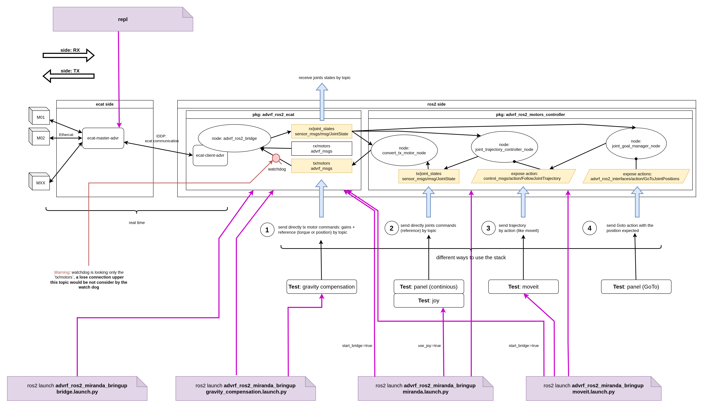

# Miranda - Quick Use


## Global Architecture



## Docker Installation 

```bash
# clone repo branch: ec_ros2/miranda
git clone https://github.com/Advanced-Robotics-Facility/advrf-dev-environment/tree/ec_ros2/miranda

# go to docker folder
cd docker/

# build​
docker compose -f compose.build.yaml build workspace​

# start the docker​
docker compose up –d ​

# enter in docker​
docker compose exec workspace bash​

# … after work... stop the docker​
docker compose down​
```

## Use Docker

To use the robot
- you shoud to have `ethercat + ros2 bridge + ros2 part`
- warning with `ROS_DOMAIN_ID`, specially if you use the robot, by default on the robot is 42

You can't see the topic on your pc once you launch next demos:
- Good ip ? same of the robot
- Good `ROS_DOMAIN_ID` ? same of the robot
- `Repl` is started on the robot ?
- `ros2 bridge` is started on the robot ? 
- try to restart the ros2 daemon: `ros2 daemon stop && ros2 daemon start`

warning: start the same `control_mode` both side there is no check between same, so be careful, because the `control_mode` is used ros2 side to know initial gains from config file.

### Use Docker in dummy mode

```bash
# start the docker​
docker compose up –d ​
```

#### Setup Ethercat Communication to ROS2 (By Docker)

```bash
## start repl in dummy mode (-d), to run fake ethercat motors
docker compose exec workspace bash​
repl -d
```

```bash
## start ros2 bridge
docker compose exec workspace bash​
ros2 launch advrf_ros2_miranda_bringup bridge.launch.py active_tx_on_first_msg:=true control_mode:=position
```
active_tx_on_first_msg:={true|false} 
control_mode:={position|impedance}

if you put `active_tx_on_first_msg:=false`, to start tx comminucation start the service:
```bash
ros2 service call /advrf/miranda/ecat/set_active_tx std_srvs/srv/SetBool '{data: true}'
```

#### Launch demos

```bash
## DEMO JOY
## start ros2 bridge
docker compose exec workspace bash​
ros2 launch advrf_ros2_miranda_bringup miranda.launch.py use_joy:=true start_bridge:=false control_mode:=position
```
start_bridge:={false|true} 
control_mode:={position|impedance}


```bash
## DEMO MOVEIT
## start ros2 bridge
docker compose exec workspace bash​
ros2 launch advrf_ros2_miranda_bringup moveit.launch.py start_bridge:=false control_mode:=position
```
start_bridge:={false|true} 
control_mode:={position|impedance}


```bash
## DEMO gravity compensation
## start ros2 bridge
docker compose exec workspace bash​
ros2 launch advrf_ros2_miranda_bringup gravity_compensation.launch.py start_bridge:=false use_rviz:=true 
```
start_bridge:={false|true} 

```bash
## Put gains to 0
ros2 service call /advrf/miranda/set_gravity_compensation std_srvs/srv/SetBool "{data: true}"
```


### Use Docker with the robot


```bash
# start the docker​
docker compose up –d ​
```

#### Setup Ethercat Communication to ROS2 (By SSH)

```bash
## start repl in the robot, password: pitagora
ssh embedded@192.168.10.101
repl 
```

```bash
## start ros2 bridge
ssh embedded@192.168.10.101
ros2 launch advrf_ros2_miranda_bringup bridge.launch.py active_tx_on_first_msg:=true control_mode:=position
```
active_tx_on_first_msg:={true|false} 
control_mode:={position|impedance}

:warning: replace `192.168.10.101` by the good robot IP.

#### Launch demos

```bash
## DEMO JOY
## start ros2 bridge
docker compose exec workspace bash​
ros2 launch advrf_ros2_miranda_bringup miranda.launch.py use_joy:=true start_bridge:=false control_mode:=position
```
start_bridge:={false|true} 
control_mode:={position|impedance}


```bash
## DEMO MOVEIT
## start ros2 bridge
docker compose exec workspace bash​
ros2 launch advrf_ros2_miranda_bringup moveit.launch.py start_bridge:=false control_mode:=position
```
start_bridge:={false|true} 
control_mode:={position|impedance}


```bash
## DEMO gravity compensation
## start ros2 bridge
docker compose exec workspace bash​
ros2 launch advrf_ros2_miranda_bringup gravity_compensation.launch.py start_bridge:=false use_rviz:=true 
```
start_bridge:={false|true} 


```bash
## Put gains to 0
ros2 service call /advrf/miranda/set_gravity_compensation std_srvs/srv/SetBool "{data: true}"
```


## Ethercat GUI

```bash
# start the docker​ if isn't started yet
docker compose up –d ​
```

:warning: `repl` should to run (dummy: localhost or robot: robot_ip)
:warning: DONT SCAN DEVICES when the robot is moving, to be sure scan device when only `repl` is started.

1. Start `ec_gui`

```bash
# reach the docker
docker compose exec workspace bash​
# execute the gui in the docker
ec_gui
```

2. Scan device

- Replace `localhost` by robot ip or keep `localhost` if you are testing in dummy mode.
- Click on scan device


## Connect PC directly to the robot

1. Connect your pc directly on the control-box/advatench
2. Edit your config network, go to `edition network` > `IPv4` 
    - select `Shared to other computers`
3. Check your ip address, it would be like  `10.42.0.1`
4. Scan the network to find the robot:
```bash
nmap -sn 10.42.0.1/24
# return something like 10.42.0.1 and 10.42.0.225 
```
5. Connect to the robot by ssh
```bash
# adapt to nmap output
ssh embedded@10.42.0.225
```

## Change watchdog timeout ms

```bash 
# edit config file on the advantech (robot), may be adapt the path, the idea is to edit the advrf_bridge from the advrf_ros2_miranda_bringup pkg
vim /home/embedded/ws/ros2_ws/src/advrf_ros2_miranda_bringup/advrf_ros2_miranda_bringup/config/advrf_bridge.yaml
# change the value 
command_timeout_ms: 10
# commpilation
cd /home/embedded/ws/ros2_ws/
colcon build
```